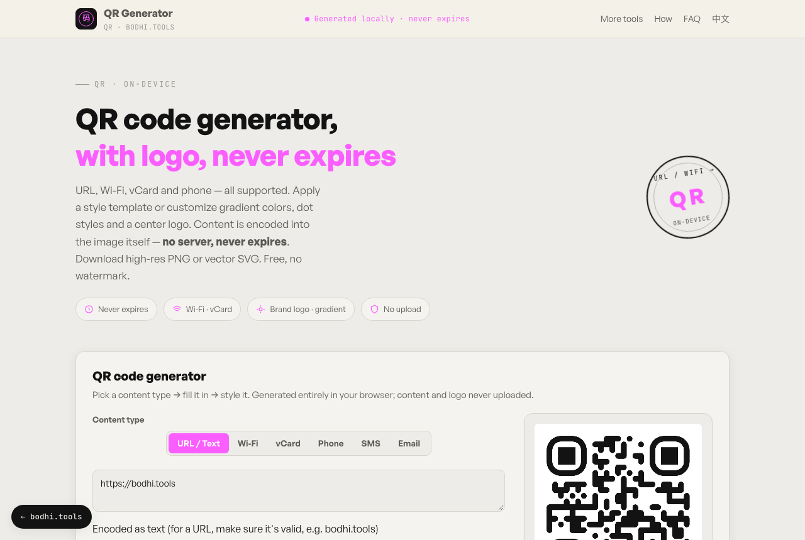

# QR Code Generator

**English** · [简体中文](README.zh-CN.md)

Make styled QR codes in your browser: URLs, Wi-Fi logins, contact cards and more, with gradients, custom dot shapes and a logo in the middle. Codes are static, so they never expire and don't depend on any server.

**Try it:** https://qrcode.bodhi.tools/en/



## Features

- Content types: URL or text, Wi-Fi (WPA/WPA2, WEP, open, hidden networks), vCard contact, phone, SMS and email
- 14 one-tap style templates
- Foreground and background colors, two-color gradients and a transparent background
- Six dot styles and three corner styles
- Center logo: pick one of 30 brand icons or upload your own image; error correction rises to level H automatically when a logo is added
- Download a 1024 × 1024 PNG or a vector SVG
- Encodes text as UTF-8, so Chinese and other non-Latin content scans correctly
- English and Simplified Chinese interface

## How it works

[qr-code-styling](https://github.com/kozakdenys/qr-code-styling) draws the code on a canvas (for PNG) or as SVG. The content is encoded directly into the image; there is no redirect link, tracking or expiry.

## Privacy

- What you type and any logo you upload stay in your browser. The app has no upload endpoint.
- Brand icons are fetched from the [Simple Icons](https://simpleicons.org) CDN when you pick one. Fonts load from Google Fonts and Fontshare.
- The hosted site at qrcode.bodhi.tools uses Cloudflare Web Analytics, which counts page views without cookies. If you self-host and don't want it, delete the `cloudflareinsights` script tag in `index.html` and `en/index.html`.

Brand icons are provided for identification only. The trademarks belong to their owners.

## Run it locally

Requires Node.js 20.19+ (or 22.12+) and [pnpm](https://pnpm.io).

```bash
git clone https://github.com/bodhi1425/qrcode.git
cd qrcode
pnpm install
pnpm dev     # http://localhost:5173
pnpm build   # static site in dist/
```

`dist/` contains only static files. Host it on Cloudflare Pages, Netlify, GitHub Pages or any web server.

## Project layout

```
index.html       Chinese page (/)
en/index.html    English page (/en/)
src/main.ts      UI, content encoding, templates and export
src/style.css    Styles
public/          favicon, robots.txt, sitemap.xml
```

## Built with

| Package | Used for | License |
|---|---|---|
| [qr-code-styling](https://github.com/kozakdenys/qr-code-styling) | QR rendering | MIT |
| [Simple Icons](https://simpleicons.org) (via CDN) | Brand icons | CC0-1.0 |
| [Vite](https://vite.dev), [TypeScript](https://www.typescriptlang.org) | Build | MIT, Apache-2.0 |

## More privacy-first tools

Each one runs entirely in your browser:

- [local-pdf-toolbox](https://github.com/bodhi1425/local-pdf-toolbox): merge, split, compress and convert PDFs
- [image-compressor](https://github.com/bodhi1425/image-compressor): compress an image to an exact KB size
- [heic-converter](https://github.com/bodhi1425/heic-converter): convert iPhone HEIC photos to JPG or PNG
- [ocr](https://github.com/bodhi1425/ocr): extract text from images
- [cutout](https://github.com/bodhi1425/cutout): remove image backgrounds with an on-device AI model

## Contributing

Bug reports and pull requests are welcome. Please open an issue first for larger changes.

## License

[MIT](LICENSE) © 2026 bodhi1425
